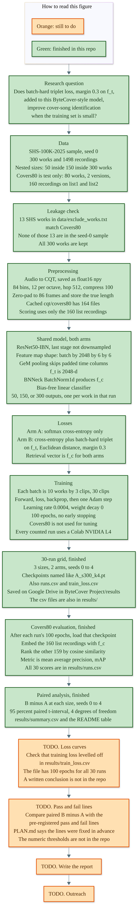
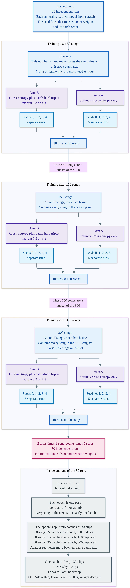

# Diagrams

How this study is put together. Names and counts match the code, `README.md`, and `PLAN.md`.

## Project flowchart



Green boxes are finished in this repo, from the research question through the 30 training runs, the Covers80 mAP scores in `results/runs.csv`, and the paired comparison in `results/summary.csv`. Orange boxes are still to do: check that training loss in `results/train_loss.csv` levelled off, compare the paired B minus A differences with the pre-registered pass and fail lines, write the report, and do outreach. `PLAN.md` says those pass and fail lines were fixed before any results. The numeric thresholds are not written in the repo.

The batch is always 30 clips, 10 works by 3 recordings. A larger training set is more songs, so a run has more batches per epoch. The batch size does not change. Each of the 30 runs trains its own model from scratch.

```mermaid
%%{init: {"theme": "base", "themeVariables": {"fontFamily": "Arial, Helvetica, sans-serif", "fontSize": "18px", "background": "#ffffff", "lineColor": "#546e7a"}, "flowchart": {"htmlLabels": true, "useMaxWidth": false, "curve": "basis", "padding": 18, "nodeSpacing": 28, "rankSpacing": 36, "wrappingWidth": 640}}}%%
flowchart TD
    classDef done fill:#c8e6c9,stroke:#1b5e20,stroke-width:2px,color:#1b3a1b
    classDef todo fill:#ffe0b2,stroke:#e65100,stroke-width:2px,color:#4e2600

    subgraph key ["How to read this figure"]
        direction LR
        keyDone["Green: finished in this repo"]
        keyTodo["Orange: still to do"]
    end

    q["Research question<br/>Does batch-hard triplet loss, margin 0.3 on f_t,<br/>added to this ByteCover-style model,<br/>improve cover-song identification<br/>when the training set is small?"]
    data["Data<br/>SHS-100K-2025 sample, seed 0<br/>300 works and 1498 recordings<br/>Nested sizes: 50 inside 150 inside 300 works<br/>Covers80 is test only: 80 works, 2 versions,<br/>160 recordings on list1 and list2"]
    leak["Leakage check<br/>13 SHS works in data/exclude_works.txt<br/>match Covers80<br/>None of those 13 are in the seed-0 sample<br/>All 300 works are kept"]
    prep["Preprocessing<br/>Audio to CQT, saved as float16 npy<br/>84 bins, 12 per octave, hop 512, compress 100<br/>Zero-pad to 86 frames and store the true length<br/>Cached cqt/covers80 has 164 files<br/>Scoring uses only the 160 list recordings"]
    model["Shared model, both arms<br/>ResNet50-IBN, last stage not downsampled<br/>Feature map shape: batch by 2048 by 6 by 6<br/>GeM pooling skips padded time columns<br/>f_t is 2048-d<br/>BNNeck BatchNorm1d produces f_c<br/>Bias-free linear classifier<br/>50, 150, or 300 outputs, one per work in that run"]
    arms["Losses<br/>Arm A: softmax cross-entropy only<br/>Arm B: cross-entropy plus batch-hard triplet<br/>on f_t, Euclidean distance, margin 0.3<br/>Retrieval vector is f_c for both arms"]
    train["Training<br/>Each batch is 10 works by 3 clips, 30 clips<br/>Forward, loss, backprop, then one Adam step<br/>Learning rate 0.0004, weight decay 0<br/>100 epochs, no early stopping<br/>Covers80 is not used for tuning<br/>Every counted run uses a Colab NVIDIA L4"]
    grid["30-run grid, finished<br/>3 sizes, 2 arms, seeds 0 to 4<br/>Checkpoints named like A_s300_k4.pt<br/>Also runs.csv and train_loss.csv<br/>Saved on Google Drive in ByteCover Project/results<br/>The csv files are also in results/"]
    ev["Covers80 evaluation, finished<br/>After each run's 100 epochs, load that checkpoint<br/>Embed the 160 list recordings with f_c<br/>Rank the other 159 by cosine similarity<br/>Metric is mean average precision, mAP<br/>All 30 scores are in results/runs.csv"]
    an["Paired analysis, finished<br/>B minus A at each size, seeds 0 to 4<br/>95 percent paired t-interval, 4 degrees of freedom<br/>results/summary.csv and the README table"]
    losscheck["TODO. Loss curves<br/>Check that training loss levelled off<br/>in results/train_loss.csv<br/>The file has 100 epochs for all 30 runs<br/>A written conclusion is not in the repo"]
    passfail["TODO. Pass and fail lines<br/>Compare paired B minus A with the<br/>pre-registered pass and fail lines<br/>PLAN.md says the lines were fixed in advance<br/>The numeric thresholds are not in the repo"]
    report["TODO. Write the report"]
    outreach["TODO. Outreach"]

    key --> q --> data --> leak --> prep --> model --> arms --> train --> grid --> ev --> an --> losscheck --> passfail --> report --> outreach

    class keyDone,q,data,leak,prep,model,arms,train,grid,ev,an done
    class keyTodo,losscheck,passfail,report,outreach todo
```



## Training structure



The three training sizes are counts of songs: 50, then 150, then 300. Each smaller set is a prefix of `data/work_order.txt`, so it sits inside the next size. They are not batch sizes. At every size, arm A and arm B each run at seeds 0, 1, 2, 3, and 4. That is 30 runs. The seed fixes that run's encoder weights and its batch order. No run continues from another run's weights.

Every batch is 10 works by 3 clips, which is 30 clips and one Adam update (learning rate 0.0004, weight decay 0). A 50-song epoch has 5 batches, so 100 epochs is 500 updates. A 150-song epoch has 15 batches, so 1,500 updates. A 300-song epoch has 30 batches, so 3,000 updates. A larger training set means more batches per epoch. The batch size stays 30, and each run trains its own model from scratch.

```mermaid
%%{init: {"theme": "base", "themeVariables": {"fontFamily": "Arial, Helvetica, sans-serif", "fontSize": "18px", "background": "#ffffff", "lineColor": "#546e7a"}, "flowchart": {"htmlLabels": true, "useMaxWidth": false, "curve": "basis", "padding": 18, "nodeSpacing": 28, "rankSpacing": 36, "wrappingWidth": 640}}}%%
flowchart TD
    classDef song fill:#e3f2fd,stroke:#1565c0,stroke-width:2px,color:#0d47a1
    classDef arm fill:#ede7f6,stroke:#4527a0,stroke-width:2px,color:#311b92
    classDef seed fill:#e1f5fe,stroke:#0277bd,stroke-width:2px,color:#01579b
    classDef sum fill:#fce4ec,stroke:#ad1457,stroke-width:2px,color:#880e4f
    classDef step fill:#eceff1,stroke:#455a64,stroke-width:2px,color:#263238

    exp["Experiment<br/>30 independent runs<br/>Each run trains its own model from scratch<br/>The seed fixes that run's encoder weights<br/>and its batch order"]

    exp --> s50

    subgraph g50 ["Training size: 50 songs"]
        direction TB
        s50["50 songs<br/>This number is how many songs the run trains on<br/>It is not a batch size<br/>Prefix of data/work_order.txt, seed-0 order"]
        s50 --> a50["Arm A<br/>Softmax cross-entropy only"]
        s50 --> b50["Arm B<br/>Cross-entropy plus batch-hard triplet<br/>margin 0.3 on f_t"]
        a50 --> k50a["Seeds 0, 1, 2, 3, 4<br/>5 separate runs"]
        b50 --> k50b["Seeds 0, 1, 2, 3, 4<br/>5 separate runs"]
        k50a --> n50["10 runs at 50 songs"]
        k50b --> n50
    end

    n50 -->|"These 50 songs are a subset of the 150"| s150

    subgraph g150 ["Training size: 150 songs"]
        direction TB
        s150["150 songs<br/>Count of songs, not a batch size<br/>Contains every song in the 50-song set"]
        s150 --> a150["Arm A<br/>Softmax cross-entropy only"]
        s150 --> b150["Arm B<br/>Cross-entropy plus batch-hard triplet<br/>margin 0.3 on f_t"]
        a150 --> k150a["Seeds 0, 1, 2, 3, 4<br/>5 separate runs"]
        b150 --> k150b["Seeds 0, 1, 2, 3, 4<br/>5 separate runs"]
        k150a --> n150["10 runs at 150 songs"]
        k150b --> n150
    end

    n150 -->|"These 150 songs are a subset of the 300"| s300

    subgraph g300 ["Training size: 300 songs"]
        direction TB
        s300["300 songs<br/>Count of songs, not a batch size<br/>Contains every song in the 150-song set<br/>1498 recordings in this set"]
        s300 --> a300["Arm A<br/>Softmax cross-entropy only"]
        s300 --> b300["Arm B<br/>Cross-entropy plus batch-hard triplet<br/>margin 0.3 on f_t"]
        a300 --> k300a["Seeds 0, 1, 2, 3, 4<br/>5 separate runs"]
        b300 --> k300b["Seeds 0, 1, 2, 3, 4<br/>5 separate runs"]
        k300a --> n300["10 runs at 300 songs"]
        k300b --> n300
    end

    n300 --> total["2 arms times 3 song-counts times 5 seeds<br/>30 independent runs<br/>No run continues from another run's weights"]

    total --> epochs

    subgraph one ["Inside any one of the 30 runs"]
        direction TB
        epochs["100 epochs, fixed<br/>No early stopping"]
        epochs --> onepass["Each epoch is one pass<br/>over that run's songs only<br/>Every song in the size is in exactly one batch"]
        onepass --> batches["The epoch is split into batches of 30 clips<br/>50 songs: 5 batches per epoch, 500 updates<br/>150 songs: 15 batches per epoch, 1500 updates<br/>300 songs: 30 batches per epoch, 3000 updates<br/>A larger set means more batches, same batch size"]
        batches --> onebatch["One batch is always 30 clips<br/>10 works by 3 clips<br/>Forward, loss, backprop<br/>One Adam step, learning rate 0.0004, weight decay 0"]
    end

    class exp,s50,s150,s300,n50,n150,n300 song
    class a50,b50,a150,b150,a300,b300 arm
    class k50a,k50b,k150a,k150b,k300a,k300b seed
    class total sum
    class epochs,onepass,batches,onebatch step
```



## Re-rendering

The `.mmd` files next to the images are the source for the figures above. From the repo root, with [Mermaid CLI](https://github.com/mermaid-js/mermaid-cli) and a white background at scale 3:

```bash
npx @mermaid-js/mermaid-cli -i docs/project_flowchart.mmd -o docs/project_flowchart.png -b white -s 3
npx @mermaid-js/mermaid-cli -i docs/training_structure.mmd -o docs/training_structure.png -b white -s 3
```

Then convert each PNG to a high-quality JPEG (4:4:4, so the text stays sharp) and replace `docs/project_flowchart.jpg` and `docs/training_structure.jpg`.
