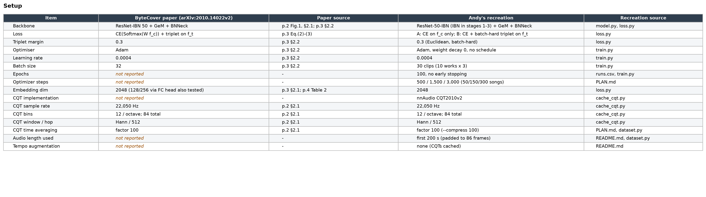
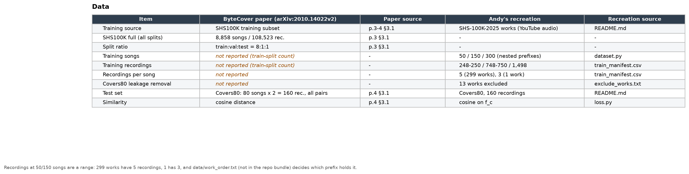
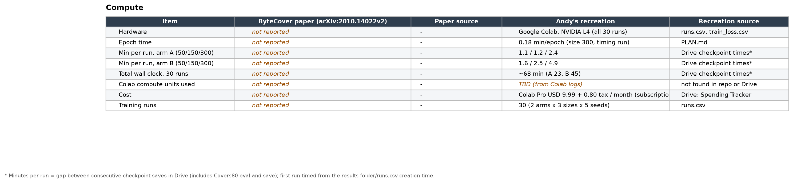
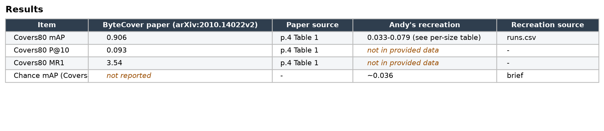
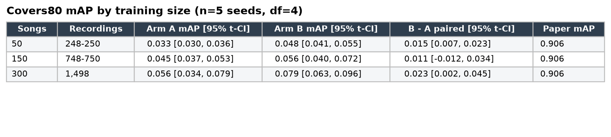
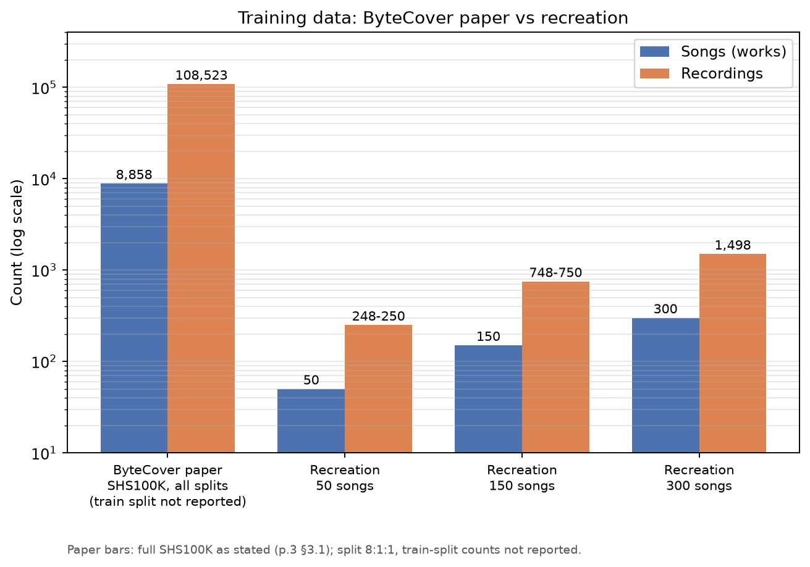
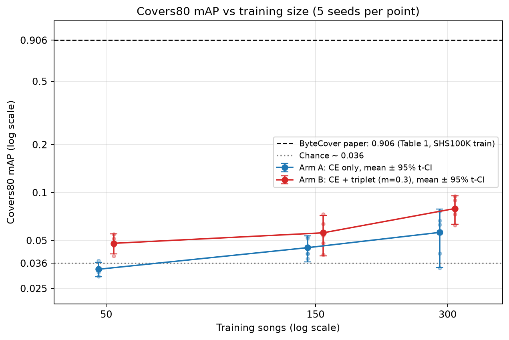

# ByteCover (Du et al., arXiv:2010.14022v2) vs Andy's small-scale recreation

## Setup

| Item | ByteCover paper (arXiv:2010.14022v2) | Paper source | Andy's recreation | Recreation source |
|---|---|---|---|---|
| Backbone | ResNet-IBN 50 + GeM + BNNeck | p.2 Fig.1, §2.1; p.3 §2.2 | ResNet-50-IBN (IBN in stages 1-3) + GeM + BNNeck | model.py, loss.py |
| Loss | CE(Softmax(W f_c)) + triplet on f_t | p.3 Eq.(2)-(3) | A: CE on f_c only; B: CE + batch-hard triplet on f_t | loss.py |
| Triplet margin | 0.3 | p.3 §2.2 | 0.3 (Euclidean, batch-hard) | loss.py |
| Optimiser | Adam | p.3 §2.2 | Adam, weight decay 0, no schedule | train.py |
| Learning rate | 0.0004 | p.3 §2.2 | 0.0004 | train.py |
| Batch size | 32 | p.3 §2.2 | 30 clips (10 works x 3) | train.py |
| Epochs | not reported | - | 100, no early stopping | runs.csv, train.py |
| Optimizer steps | not reported | - | 500 / 1,500 / 3,000 (50/150/300 songs) | PLAN.md |
| Embedding dim | 2048 (128/256 via FC head also tested) | p.3 §2.1; p.4 Table 2 | 2048 | loss.py |
| CQT implementation | not reported | - | nnAudio CQT2010v2 | cache_cqt.py |
| CQT sample rate | 22,050 Hz | p.2 §2.1 | 22,050 Hz | cache_cqt.py |
| CQT bins | 12 / octave; 84 total | p.2 §2.1 | 12 / octave; 84 total | cache_cqt.py |
| CQT window / hop | Hann / 512 | p.2 §2.1 | Hann / 512 | cache_cqt.py |
| CQT time averaging | factor 100 | p.2 §2.1 | factor 100 (--compress 100) | PLAN.md, dataset.py |
| Audio length used | not reported | - | first 200 s (padded to 86 frames) | README.md, dataset.py |
| Tempo augmentation | not reported | - | none (CQTs cached) | README.md |

## Data

| Item | ByteCover paper (arXiv:2010.14022v2) | Paper source | Andy's recreation | Recreation source |
|---|---|---|---|---|
| Training source | SHS100K training subset | p.3-4 §3.1 | SHS-100K-2025 works (YouTube audio) | README.md |
| SHS100K full (all splits) | 8,858 songs / 108,523 rec. | p.3 §3.1 | - | - |
| Split ratio | train:val:test = 8:1:1 | p.3 §3.1 | - | - |
| Training songs | not reported (train-split count) | - | 50 / 150 / 300 (nested prefixes) | dataset.py |
| Training recordings | not reported (train-split count) | - | 248-250 / 748-750 / 1,498 | train_manifest.csv |
| Recordings per song | not reported | - | 5 (299 works), 3 (1 work) | train_manifest.csv |
| Covers80 leakage removal | not reported | - | 13 works excluded | exclude_works.txt |
| Test set | Covers80: 80 songs x 2 = 160 rec., all pairs | p.4 §3.1 | Covers80, 160 recordings | README.md |
| Similarity | cosine distance | p.4 §3.1 | cosine on f_c | loss.py |

Recordings at 50/150 songs are a range: 299 works have 5 recordings, 1 has 3, and data/work_order.txt (not in the repo bundle) decides which prefix holds it.

## Compute

| Item | ByteCover paper (arXiv:2010.14022v2) | Paper source | Andy's recreation | Recreation source |
|---|---|---|---|---|
| Hardware | not reported | - | Google Colab, NVIDIA L4 (all 30 runs) | runs.csv, train_loss.csv |
| Epoch time | not reported | - | 0.18 min/epoch (size 300, timing run) | PLAN.md |
| Min per run, arm A (50/150/300) | not reported | - | 1.1 / 1.2 / 2.4 | Drive checkpoint times* |
| Min per run, arm B (50/150/300) | not reported | - | 1.6 / 2.5 / 4.9 | Drive checkpoint times* |
| Total wall clock, 30 runs | not reported | - | ~68 min (A 23, B 45) | Drive checkpoint times* |
| Colab compute units used | not reported | - | TBD (from Colab logs) | not found in repo or Drive |
| Cost | not reported | - | Colab Pro USD 9.99 + 0.80 tax / month (subscription) | Drive: Spending Tracker |
| Training runs | not reported | - | 30 (2 arms x 3 sizes x 5 seeds) | runs.csv |

* Minutes per run = gap between consecutive checkpoint saves in Drive (includes Covers80 eval and save); first run timed from the results folder/runs.csv creation time.

## Results

| Item | ByteCover paper (arXiv:2010.14022v2) | Paper source | Andy's recreation | Recreation source |
|---|---|---|---|---|
| Covers80 mAP | 0.906 | p.4 Table 1 | 0.033-0.079 (see per-size table) | runs.csv |
| Covers80 P@10 | 0.093 | p.4 Table 1 | not in provided data | - |
| Covers80 MR1 | 3.54 | p.4 Table 1 | not in provided data | - |
| Chance mAP (Covers80) | not reported | - | ~0.036 | brief |

## Covers80 mAP by training size (n=5 seeds, df=4)

| Songs | Recordings | Arm A mAP [95% t-CI] | Arm B mAP [95% t-CI] | B - A paired [95% t-CI] | Paper mAP |
|---|---|---|---|---|---|
| 50 | 248-250 | 0.033 [0.030, 0.036] | 0.048 [0.041, 0.055] | 0.015 [0.007, 0.023] | 0.906 |
| 150 | 748-750 | 0.045 [0.037, 0.053] | 0.056 [0.040, 0.072] | 0.011 [-0.012, 0.034] | 0.906 |
| 300 | 1,498 | 0.056 [0.034, 0.079] | 0.079 [0.063, 0.096] | 0.023 [0.002, 0.045] | 0.906 |

## Plots

